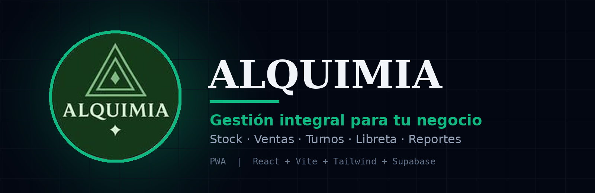
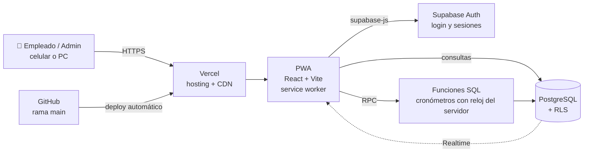
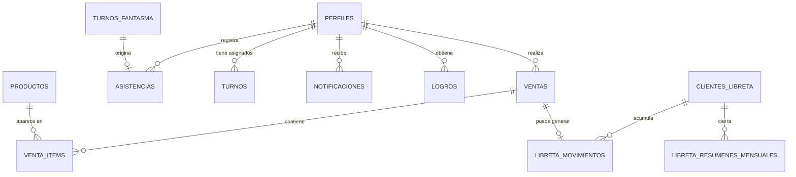

<p align="center">
  
</p>

<p align="center">
  
  
  
  
  
  
</p>

# Alquimia App

Aplicación web progresiva (PWA) para administrar un comercio minorista pequeño: **control de stock, ventas, turnos del personal, libreta de clientes (fiado) y reportes mensuales**, todo desde el celular o la PC, sin instalar nada desde una tienda de aplicaciones.

---

## Índice

1. [¿Para qué se hizo?](#para-qué-se-hizo)
2. [Capturas](#capturas)
3. [Funcionalidades](#funcionalidades)
4. [Roles y permisos](#roles-y-permisos)
5. [Tecnologías utilizadas](#tecnologías-utilizadas)
6. [Arquitectura](#arquitectura)
7. [Estructura del proyecto](#estructura-del-proyecto)
8. [Componentes y para qué sirven](#componentes-y-para-qué-sirven)
9. [Base de datos](#base-de-datos)
10. [Seguridad](#seguridad)
11. [Instalación y uso local](#instalación-y-uso-local)
12. [Deploy](#deploy)
13. [Instalar como app (PWA)](#instalar-como-app-pwa)
14. [Hoja de ruta](#hoja-de-ruta)

---

## ¿Para qué se hizo?

Alquimia nació de una necesidad concreta: una tienda donde **todos los empleados son parte del mismo equipo** (no hay una jerarquía formal) y hasta ahora todo se llevaba en cuadernos y de memoria. Los problemas que resuelve:

- **Saber qué hay y qué falta**: el stock se actualiza solo con cada venta y avisa cuando un producto está por agotarse.
- **Registrar cada venta** con su forma de pago (efectivo, transferencia o libreta), sin depender de papelitos.
- **Llevar el fiado ordenado**: quién se llevó qué, cuándo, cuánto debe, y poder entregarle una boleta en PDF a fin de mes.
- **Controlar horarios reales**: cada empleado ficha su entrada y salida con un cronómetro, y las horas quedan registradas.
- **Cubrir ausencias**: si alguien no puede ir, publica una cobertura y cualquier compañero la toma ("turno fantasma").
- **Ver cómo viene el negocio**: reportes que se reinician cada mes, caja del día y rankings para motivar al equipo.

El enfoque es **mobile first**: la mayor parte del uso real ocurre desde el celular, de pie, en el mostrador.

---

## Capturas

> Las capturas viven en `docs/screenshots/`. Reemplazalas por capturas actuales de tu celular (se recomienda 390 × 844 px).

<table>
  <tr>
    <td align="center"><br /><sub><b>Inicio de sesión</b></sub></td>
    <td align="center"><br /><sub><b>Stock</b></sub></td>
    <td align="center"><br /><sub><b>Punto de venta</b></sub></td>
  </tr>
  <tr>
    <td align="center"><br /><sub><b>Turnos y fichaje</b></sub></td>
    <td align="center"><br /><sub><b>Libreta de clientes</b></sub></td>
    <td align="center"><br /><sub><b>Reportes del mes</b></sub></td>
    <td align="center"><br /><sub><b>Turno Fantasma</b></sub></td>
  </tr>
</table>

---

## Funcionalidades

### Stock
- Alta y edición de productos con precio de compra, precio de venta, stock actual y stock mínimo.
- Alerta visual de **stock bajo** cuando el producto llega o baja del mínimo.
- Organización por **categorías** y **barra de búsqueda** para encontrar productos rápido.
- Cálculo de ganancia por unidad.

### Ventas (punto de venta)
- Navegación por categorías o búsqueda directa, con carrito (ticket actual).
- Método de pago: **efectivo, transferencia o libreta**.
- Descuento automático de stock al confirmar.
- Si el pago es por libreta, se elige (o se crea al vuelo) el cliente y la venta queda anotada en su cuenta.
- Historial de **ventas del día**.
- Modal de felicitación cuando un empleado alcanza ciertos montos de venta diaria.

### Turnos
- Horarios semanales por empleado (día y franja horaria).
- **Fichaje con cronómetro**: el empleado inicia y finaliza su jornada y se guarda la hora exacta, medida por el servidor.
- Las horas trabajadas alimentan los reportes y el ranking mensual.

### Turno fantasma (coberturas)
- Cualquier empleado puede **pedir cobertura** cuando no puede asistir.
- Cualquier compañero puede **tomarla**, con un cronómetro que registra las horas realmente trabajadas.

### Libreta (fiado)
- Una **cuenta por cliente**, con historial de movimientos (fecha, hora, detalle, monto).
- Selector de **mes con calendario**: cada mes se ve por separado.
- Marcar movimientos como pagados.
- **Cierre de mes** que genera una **boleta en PDF** con la lista de productos, fechas, montos y total a abonar. Las boletas de meses anteriores se pueden volver a descargar.

### Reportes
- Se **reinician solos cada mes**: ventas totales, cantidad de operaciones, productos más vendidos, ventas por categoría y por empleado.
- **Caja del día** desglosada por método de pago.
- **Rankings mensuales** de ventas y de horas trabajadas.

### Logros y notificaciones
- Mensajes de felicitación por hitos de **días trabajados** (10, 25, 50, 75, 100) y de **venta diaria** ($50.000, $70.000, $80.000, $90.000, $100.000).
- Notificaciones dentro de la app en tiempo real (stock bajo, turnos asignados, logros).

### Cuenta
- Registro e inicio de sesión con email y contraseña.
- Recuperación de contraseña por email y cambio de contraseña desde la app.

---

## Roles y permisos

| Acción | Empleado | Admin |
|---|:---:|:---:|
| Ver y editar stock | ✅ | ✅ |
| Registrar ventas | ✅ | ✅ |
| Usar la libreta y generar boletas | ✅ | ✅ |
| Fichar turnos y tomar coberturas | ✅ | ✅ |
| Ver reportes | ✅ | ✅ |
| **Eliminar ventas** | ❌ | ✅ |
| **Eliminar turnos fantasma** | ❌ | ✅ |

La restricción se aplica **en la base de datos** (políticas RLS), no solo ocultando botones en la interfaz.

---

## Tecnologías utilizadas

| Capa | Tecnología | Para qué se usa |
|---|---|---|
| Interfaz | **React 19** | Componentes y estado de cada pantalla |
| Build | **Vite** | Servidor de desarrollo y empaquetado |
| Estilos | **Tailwind CSS v4** | Diseño responsive, tema oscuro con acento esmeralda |
| Íconos | **lucide-react** | Iconografía consistente |
| Backend / BD | **Supabase** (PostgreSQL) | Base de datos, autenticación y tiempo real |
| Seguridad de datos | **Row Level Security** | Permisos por rol a nivel de base de datos |
| PWA | **vite-plugin-pwa** | Manifest, service worker e instalación |
| PDF | **jsPDF** | Generación de boletas en el navegador |
| Hosting | **Vercel** | Deploy automático desde GitHub, con HTTPS |
| Control de versiones | **Git + GitHub** | Cada `push` a `main` dispara un deploy |

---

## Arquitectura

La app es un **frontend único** que habla directamente con Supabase. No hay servidor propio: la lógica sensible vive en la base de datos (políticas RLS y funciones SQL).



**Decisiones de diseño relevantes**

- **Cronómetros medidos por el servidor**: al finalizar un turno, la duración se calcula con el reloj de la base de datos (función SQL), no con el del celular, para que no dependa de que el dispositivo tenga la hora bien puesta.
- **Reportes mensuales por consulta**: no se borra nada al cambiar de mes; los reportes simplemente filtran desde el día 1, así el historial queda disponible.
- **Navegación por estado**: no hay router; `App.jsx` decide qué pantalla mostrar según la pestaña activa.

---

## Estructura del proyecto

```
alquimia-app/
├── docs/
│   ├── banner.png
│   ├── logo.jpg
│   └── screenshots/          ← capturas para este README
├── public/
│   ├── icon-192.png          ← ícono de la PWA
│   └── icon-512.png
├── src/
│   ├── components/           ← una pantalla (o pieza de UI) por archivo
│   ├── lib/
│   │   ├── supabaseClient.js ← cliente de Supabase
│   │   ├── logros.js         ← lógica de hitos y felicitaciones
│   │   └── useEsAdmin.js     ← hook: ¿el usuario actual es admin?
│   ├── App.jsx               ← estructura general, sesión y navegación
│   ├── index.css             ← tema y estilos globales (Tailwind v4)
│   ├── main.jsx
│   └── sw.js                 ← service worker (si se usa estrategia injectManifest)
├── index.html
├── vite.config.js            ← React + Tailwind + PWA
└── package.json
```

---

## Componentes y para qué sirven

### Estructura general

| Componente | Función |
|---|---|
| `App.jsx` | Gestiona la sesión, muestra el login o la app, y decide qué pantalla renderizar según la pestaña activa. Contiene el header con el logo y las notificaciones. |
| `BottomNav.jsx` | Barra de navegación inferior (pensada para el pulgar) con las secciones principales. |
| `MasSheet.jsx` | Panel deslizable "Más" con accesos secundarios: turno fantasma, cambiar contraseña y cerrar sesión. |

### Acceso y cuenta

| Componente | Función |
|---|---|
| `Login.jsx` | Inicio de sesión, registro de cuenta nueva y recuperación de contraseña por email. |
| `CambiarPassword.jsx` | Modal para definir una contraseña nueva (también se abre al volver desde el link del email de recuperación). |

### Módulos de negocio

| Componente | Función |
|---|---|
| `Stock.jsx` | Listado y alta de productos, categorías, búsqueda, ajuste de cantidades y alerta de stock bajo. |
| `Ventas.jsx` | Punto de venta: categorías, carrito, método de pago, conexión con la libreta, historial de ventas del día y eliminación (solo admin). |
| `Turnos.jsx` | Horarios semanales y fichaje con cronómetro de la jornada del empleado. |
| `TurnoFantasma.jsx` | Pedido y toma de coberturas, con cronómetro y registro de horas reales. |
| `Libreta.jsx` | Lista de clientes con saldo, detalle de cuenta por mes, marcado de pagos, cierre de mes y generación de boletas PDF. |
| `Reportes.jsx` | Métricas del mes en curso, caja del día y rankings de ventas y horas. |

### Piezas de apoyo

| Componente | Función |
|---|---|
| `Notificaciones.jsx` | Campanita con contador y panel de avisos, actualizada en tiempo real. |
| `LogroModal.jsx` | Modal de felicitación al alcanzar un hito. |

### Utilidades (`src/lib`)

| Archivo | Función |
|---|---|
| `supabaseClient.js` | Crea el cliente de Supabase a partir de las variables de entorno. |
| `logros.js` | Calcula si el empleado alcanzó un hito de días trabajados o ventas, y evita repetir la misma felicitación. |
| `useEsAdmin.js` | Hook que consulta el rol del usuario actual para mostrar u ocultar acciones de administrador. |

---

## Base de datos

PostgreSQL gestionado por Supabase.



| Tabla | Contenido |
|---|---|
| `perfiles` | Datos del usuario y su rol (`admin` o `empleado`). Se crea sola al registrarse. |
| `productos` | Catálogo con precios, stock actual/mínimo y categoría. |
| `categorias` | Categorías para agrupar productos. |
| `ventas` / `venta_items` | Cabecera de cada venta (total, método de pago, vendedor) y su detalle de productos. |
| `turnos` | Horarios semanales por empleado. |
| `turnos_fantasma` | Solicitudes de cobertura, con estado y duración real. |
| `asistencias` | Registro real de jornadas trabajadas (fijas y coberturas) con su duración. |
| `clientes_libreta` | Clientes que compran fiado. |
| `libreta_movimientos` | Cada anotación de fiado: fecha, hora, detalle, monto y si fue pagada. |
| `libreta_resumenes_mensuales` | Cierres de mes por cliente. |
| `notificaciones` | Avisos para cada usuario. |
| `logros` | Hitos ya alcanzados, para no repetir felicitaciones. |

Además hay **funciones SQL** que finalizan los cronómetros usando el reloj del servidor, y **triggers** que crean el perfil al registrarse y generan avisos de stock bajo.

---

## Seguridad

- **Autenticación** a cargo de Supabase Auth.
- **Row Level Security** activado en las tablas; las acciones destructivas sensibles (eliminar ventas y coberturas) están restringidas al rol `admin` directamente en la base.
- El frontend usa únicamente la **clave pública (publishable)** de Supabase. La **clave secreta nunca debe incluirse** en el código ni en las variables `VITE_*`, porque todo lo que empieza con `VITE_` queda visible en el navegador.
- El archivo `.env` está en `.gitignore` y **no se sube** al repositorio.

---

## Instalación y uso local

**Requisitos:** Node.js (versión LTS) y una cuenta de Supabase con el esquema de la base ya creado.

```bash
# 1. Clonar e instalar dependencias
git clone https://github.com/<tu-usuario>/alquimia-app.git
cd alquimia-app
npm install

# 2. Configurar variables de entorno
#    Crear un archivo .env en la raíz con:
#      VITE_SUPABASE_URL=<url de tu proyecto Supabase>
#      VITE_SUPABASE_ANON_KEY=<clave publishable de Supabase>

# 3. Levantar el servidor de desarrollo
npm run dev
```

Otros comandos útiles:

```bash
npm run build     # genera la versión de producción en /dist
npm run preview   # sirve esa versión para probarla (y probar la instalación PWA)
```

---

## Deploy

El proyecto está conectado a **Vercel** a través de GitHub:

1. Subir los cambios: `git add .` → `git commit -m "mensaje"` → `git push`.
2. Vercel detecta el push a `main` y publica una versión nueva en un par de minutos.
3. Las variables de entorno (`VITE_SUPABASE_URL` y `VITE_SUPABASE_ANON_KEY`) se cargan en **Vercel → Settings → Environment Variables**.
4. En Supabase, agregar la URL pública en **Authentication → URL Configuration** (Site URL y Redirect URLs) para que funcionen el login y la recuperación de contraseña.

> Importante: Linux (el sistema de Vercel) distingue mayúsculas de minúsculas en los nombres de archivo y Windows no. Si un componente se importa como `./components/Login`, el archivo debe llamarse exactamente `Login.jsx`.

---

## Instalar como app (PWA)

**Android (Chrome):** abrir la URL → menú ⋮ → **Instalar app** (o *Agregar a pantalla de inicio*).

**PC con Windows (Chrome/Edge):** abrir la URL → ícono de instalar en la barra de direcciones → **Instalar**.

Queda con su propio ícono y se abre en ventana propia, como una app nativa.

> Si después de una actualización alguien sigue viendo la versión vieja: cerrar la app por completo y volver a abrirla; si persiste, desinstalarla y reinstalarla.

---

## Hoja de ruta

- [ ] Notificaciones push nativas del sistema (hoy las notificaciones viven dentro de la app).
- [ ] Cierre de caja diario archivado.
- [ ] Revisión de seguridad, pruebas automatizadas y optimización de rendimiento.
- [ ] Mejoras de diseño en Stock.

---

## Autor

Desarrollado por **Matías Toledo** para el comercio **Alquimia**, Monteros, Tucumán, Argentina.
